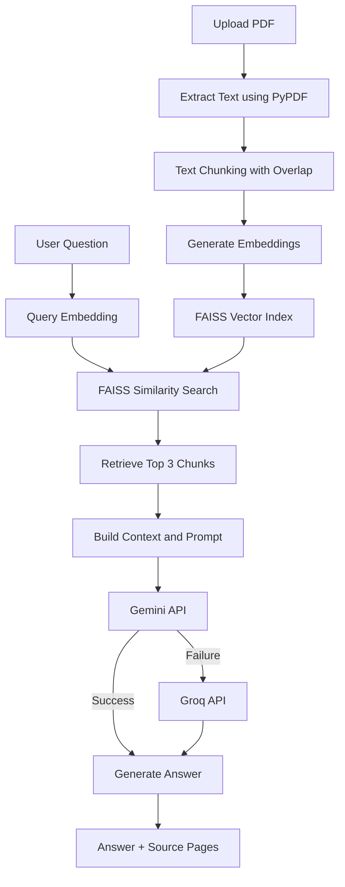

# 📚 PDF RAG Assistant

An AI-powered PDF Question Answering application built using **Retrieval-Augmented Generation (RAG)**. Upload a PDF, ask questions about its contents, and receive context-aware answers with relevant source page references.

🔗 **Live Demo:** https://pdf-rag-assistant-ihnfcs9bszsg2gxzrgv3gv.streamlit.app/

🔗 **GitHub Repository:** https://github.com/GauravK221b/pdf-rag-assistant

## 🚀 Features

- **PDF Upload:** Upload text-based PDF documents directly through the Streamlit interface.
- **Text Extraction:** Extract text from individual PDF pages using PyPDF.
- **Text Chunking:** Split extracted text into smaller chunks with overlapping content to preserve context.
- **Semantic Embeddings:** Generate 384-dimensional embeddings using Sentence Transformers (`all-MiniLM-L6-v2`).
- **Vector Search:** Use FAISS with normalized embeddings and inner-product similarity search.
- **Context-Aware Answers:** Retrieve the top 3 relevant chunks and provide them to an LLM for answer generation.
- **LLM Integration:** Gemini as the primary provider with Groq as a fallback.
- **Source References:** Display relevant PDF page numbers and retrieved passages alongside answers.
- **Secure Configuration:** Store API keys using environment variables locally and Streamlit Secrets in deployment.

## 📸 Application Screenshots

### 1. PDF Upload Interface

Upload a PDF document through the Streamlit application.


### 2. PDF Processing

The application extracts text and prepares the document for semantic retrieval.


### 3. Question Answering

Ask questions about the uploaded PDF and receive context-aware answers with the LLM provider displayed.


### 4. Retrieved Sources

Inspect the retrieved PDF passages, source page numbers, and similarity scores.


## 🏗️ System Architecture



## 🛠️ Tech Stack

| Component | Technology |
|---|---|
| Programming Language | Python |
| Frontend | Streamlit |
| PDF Processing | PyPDF |
| Embedding Model | all-MiniLM-L6-v2 |
| Vector Database | FAISS |
| Numerical Computing | NumPy |
| Primary LLM | Google Gemini |
| Fallback LLM | Groq |
| Environment Management | python-dotenv |
| Deployment | Streamlit Community Cloud |

## ⚙️ How It Works

### 1. PDF Processing
The application extracts text from each PDF page and maintains its original page number.

### 2. Text Chunking
Extracted text is divided into chunks of 500 characters with an overlap of 50 characters.

### 3. Embedding Generation
The `all-MiniLM-L6-v2` model converts each text chunk into a 384-dimensional vector representation.

### 4. Vector Indexing
FAISS stores the normalized embeddings using `IndexFlatIP`. Inner-product similarity on normalized vectors is equivalent to cosine similarity.

### 5. Retrieval
The user's question is converted into an embedding. FAISS retrieves the top 3 most relevant chunks.

### 6. Answer Generation
The retrieved passages are provided as context to Gemini. If Gemini fails, the application automatically switches to Groq.

The LLM is instructed to answer only using the supplied PDF context and indicate when the answer is unavailable.

### 7. Source Attribution
The application displays the generated answer, source page numbers, retrieved passages, and similarity scores.

## 💻 Installation and Setup

### Prerequisites

- Python 3.10 or later
- Git
- Gemini API key
- Groq API key

### 1. Clone the Repository

```bash
git clone https://github.com/GauravK221b/pdf-rag-assistant.git
cd pdf-rag-assistant
```

### 2. Create a Virtual Environment

```bash
python -m venv venv
```

Activate it on Windows:

```powershell
venv\Scripts\activate
```

### 3. Install Dependencies

```bash
pip install -r requirements.txt
```

### 4. Configure API Keys

Create a `.env` file in the project root:

```env
GEMINI_API_KEY=your_gemini_api_key
GROQ_API_KEY=your_groq_api_key
```

Never commit your `.env` file or expose your API keys.

### 5. Run the Application

```bash
streamlit run app.py
```

Open the local URL displayed in your terminal.

## 📊 Evaluation

The initial retrieval evaluation was conducted using five predefined questions on a sample PDF.

| Evaluation Metric | Result |
|---|---:|
| Page-based Hit@3 | 4/5 (80%) |
| Manually assessed Top-3 relevance | 5/5 (100%) |

**Note:** The manual relevance result is based on inspection of the retrieved passages. These are preliminary results from a small evaluation set, not a general performance guarantee.

## ☁️ Deployment

The application is deployed using Streamlit Community Cloud.

1. Push the project to GitHub.
2. Connect the repository to Streamlit Community Cloud.
3. Configure `GEMINI_API_KEY` and `GROQ_API_KEY` under App Settings → Secrets.
4. Deploy the application using `app.py` as the entry point.

🔗 **Live Application:** https://pdf-rag-assistant-ihnfcs9bszsg2gxzrgv3gv.streamlit.app/

## 📁 Project Structure

```text
pdf-rag-assistant/
│
├── app.py              # Streamlit application
├── rag.py              # RAG pipeline and LLM integration
├── requirements.txt    # Project dependencies
├── README.md           # Project documentation
├── .gitignore          # Ignored files and secrets
└── .env                # Local API keys (not committed)
```

## 🔮 Future Improvements

- Support multiple PDF documents.
- Add conversational chat history.
- Implement hybrid search using keyword and semantic retrieval.
- Introduce reranking for improved retrieval relevance.
- Add OCR support for scanned PDF documents.
- Expand automated evaluation with larger question sets.

## 👨‍💻 Author

**Gaurav Kumar**

B.Tech – Computer Science Engineering (AI & ML)

- GitHub: https://github.com/GauravK221b

---

⭐ If you find this project useful, consider giving the repository a star!
